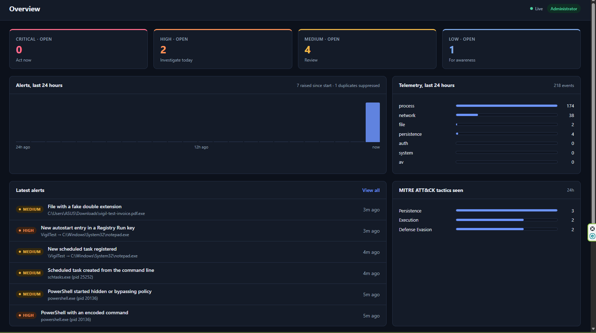
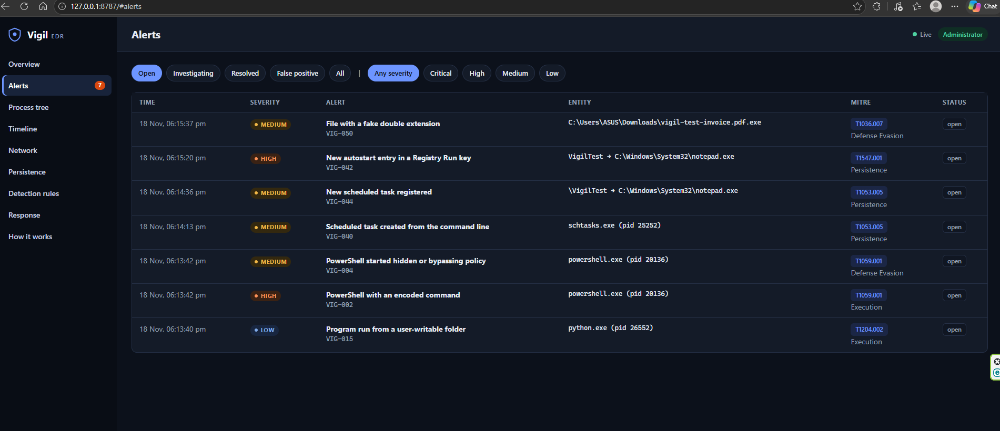
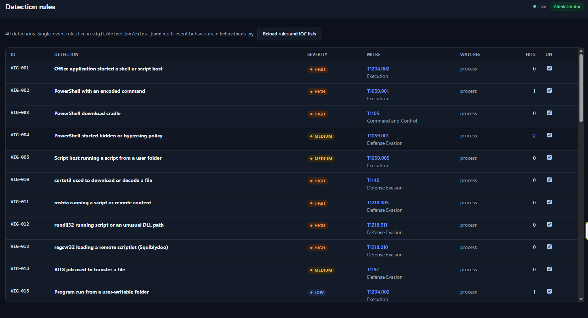

# Vigil EDR

A lightweight **Endpoint Detection and Response** agent for Windows, written in readable Python.
Vigil watches processes, network connections, files, autostart locations and Windows event logs,
detects attacker behaviour with 40 detections mapped to **MITRE ATT&CK**, and lets you respond
(kill, suspend, quarantine, block an IP, isolate the host) from a local web dashboard.



It is built to be understood: every module is short and commented, and [LEARN.md](LEARN.md)
walks through how it works and how it compares with commercial EDRs.

## Features

| Area | What Vigil does |
| --- | --- |
| **Process telemetry** | Every new process with its command line, parent, user and SHA-256. Uses Sysmon event 1 automatically when Sysmon is installed. |
| **Network telemetry** | Outbound connections linked to the process that made them. |
| **File telemetry** | New executables and scripts in Downloads, Desktop, Temp, Startup and Public, hashed on arrival. |
| **Persistence** | Baseline and change detection for Run keys, Startup folders, scheduled tasks and services. |
| **Windows event logs** | Failed logons, account creation, group changes, log clearing, new services, Defender detections. |
| **Detection** | 36 single-event rules (JSON) and 4 multi-event behaviours (brute force, recon burst, shell burst, beaconing). Every one is mapped to a MITRE ATT&CK technique. |
| **Threat intel** | Local IOC lists for hashes and IPs, plus optional VirusTotal lookups. |
| **Response** | Kill, suspend or resume a process tree, quarantine and restore files, block or unblock IPs in Windows Firewall, isolate the host. Every action needs confirmation and is audited. |
| **Dashboard** | Overview, alert triage with evidence and guidance, live process tree, timeline search, network view, autostart inventory, rule manager, response centre. |
| **Testing** | A safe attack simulator and 24 unit tests. |

## Screenshots

| Alert triage | Detection rules mapped to MITRE ATT&CK |
| --- | --- |
|  |  |

## Quick start (Windows)

1. Install **Python 3.10 or newer** from [python.org](https://www.python.org/downloads/) and tick *Add Python to PATH*.
2. Download or clone this folder.
3. Right-click **`start.bat`** and choose **Run as administrator**.
   (It creates a virtual environment, installs `psutil` and `Flask`, and starts Vigil.)
4. The dashboard opens at **http://127.0.0.1:8787**.

Prefer the terminal?

```powershell
python -m venv .venv
.venv\Scripts\activate
pip install -r requirements.txt
python run.py
```

Running as Administrator gives full coverage: the Security event log, every process's
connections and firewall actions. Without it, Vigil still runs with reduced visibility and tells you what is missing.

### Recommended: install Sysmon

[Sysmon](https://learn.microsoft.com/sysinternals/downloads/sysmon) (free, from Microsoft Sysinternals) records
every process creation, even ones that start and stop within milliseconds. Vigil detects Sysmon automatically
and switches to it for process, network, file and registry events.

```powershell
sysmon64.exe -accepteula -i sysmonconfig.xml
```

A good community configuration is [SwiftOnSecurity/sysmon-config](https://github.com/SwiftOnSecurity/sysmon-config).

## Try it

With Vigil running, open a second terminal in the same folder:

```powershell
python tools\simulate.py          # harmless commands that look like attacks, cleaned up afterwards
python tools\simulate.py --inject # synthetic events straight into the pipeline (any OS)
python tools\simulate.py --list   # see what each test does
```

Then open **Alerts** in the dashboard, click an alert, read *What happened* and *What to do*, and respond.

## Run the tests

```powershell
python -m unittest discover tests -v
```

## Configuration

Copy `config.example.json` to `config.json` and change what you need (port, VirusTotal API key,
watched folders, retention, response on or off). Every setting is documented in `vigil/config.py`.

Add your own indicators to `iocs/bad_hashes.txt` and `iocs/bad_ips.txt`; they reload every minute.

## Project layout

```
run.py                      start the agent and the dashboard
start.bat                   one-click start on Windows
vigil/
  config.py                 settings
  db.py                     SQLite storage: events, alerts, actions, quarantine
  pipeline.py               collect -> enrich -> store -> detect -> alert
  agent.py                  wires everything together
  collectors/               the sensors
    process.py  network.py  files.py  persistence.py  eventlog.py
  detection/
    engine.py               JSON rule engine (all / any / none, 13 operators)
    rules.json              the rules (generated from tools/build_rules.py)
    behaviours.py           multi-event detections with sliding time windows
    intel.py                IOC lists and VirusTotal
  response.py               kill, suspend, quarantine, block IP, isolate
  web.py                    Flask API with token and host checks
  static/                   the dashboard (plain HTML, CSS, JavaScript)
tools/
  build_rules.py            author rules in Python, export to JSON
  simulate.py               safe attack simulator
tests/                      unit tests
iocs/                       your indicator lists
data/                       created at run time: vigil.db, quarantine/
```

## Security design

- The dashboard listens on **127.0.0.1 only**.
- Requests must use host `127.0.0.1` or `localhost` (blocks DNS rebinding).
- Every state-changing request needs a per-run random token (blocks cross-site request forgery).
- Everything displayed is HTML-escaped, because process names and command lines are attacker-controlled.
- Commands are run without a shell, so no input can be injected into them.
- Response actions refuse core Windows processes, System32 files, loopback addresses, and Vigil's own process tree.

## Limitations

Vigil is a learning and portfolio project, not a replacement for Microsoft Defender or a commercial EDR.
It runs in user mode, so it polls instead of hooking the kernel, has no tamper protection, and can be stopped
by an attacker with admin rights. [LEARN.md](LEARN.md) explains each gap and how commercial products close it.

## License

MIT (see [LICENSE](LICENSE)). Use it, learn from it, extend it.

Built by **Syed Ishrar Ali**, SOC Lead and Microsoft Sentinel engineer.
